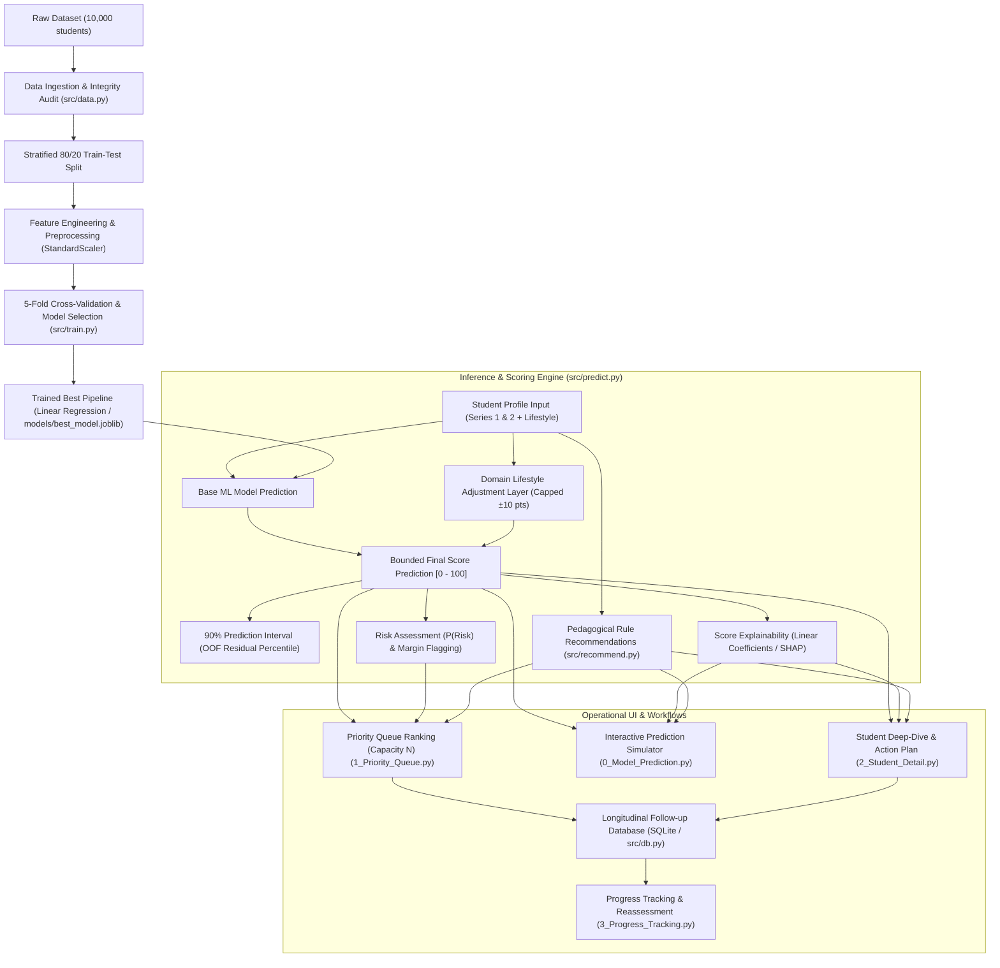

# System Architecture, Evolution & Technical Guide (`how.md`)

## 1. Executive Summary

This document explains the end-to-end inner workings of the **Student Performance Prediction & Personalized Support System**, details what technologies were chosen and their precise purpose, and documents the chronological evolution of changes (**what was changed, why it was changed, and how it was changed**).

---

## 2. How the System Works (End-to-End Workflow)



### 2.1 Step-by-Step Pipeline Mechanics

1. **Data Ingestion & Range Validation (`src/data.py`)**:
   - Ingests `student_performance_10000-1.csv` (10,000 records).
   - Validates that values fall within acceptable educational ranges (`series_1`: 0–40, `series_2`: 0–40, `attendance_percentage`: 40–100%, `study_hours_per_day`: 0.5–6.0, `social_media_hours`: 0–6.0, `final_exam_score`: 0–100).
   - Verifies zero missing values and zero duplicate rows.
   - Performs an 80/20 train/test split stratified on 10 quantile bins of `final_exam_score` to prevent distribution drift.

2. **Model Training & Cross-Validation (`src/train.py`)**:
   - Evaluates Linear Regression, Random Forest, and Gradient Boosting across 5 stratified folds.
   - Applies the **1-Standard-Error (1-SE) rule**: Linear Regression achieves CV RMSE of $6.765 \pm 0.087$, which is statistically identical to complex tree models (RF: $6.819$, GBR: $6.799$). Linear Regression is selected for parsimony, full coefficient transparency, and speed.
   - Preprocessing pipelines fit the `StandardScaler` strictly on the training fold, avoiding test leakage.

3. **Inference & The Lifestyle Adjustment Layer (`src/predict.py`)**:
   - **Academic Base Score**: Continuous exam marks from `series_1` and `series_2` generate the core linear prediction.
   - **Lifestyle Adjustment**: The underlying dataset is synthetically generated, meaning lifestyle factors have near-zero empirical correlation with exam scores ($|r| \le 0.01$). If left solely to ML regression, lifestyle sliders would have zero perceptible impact. To bridge empirical limits and pedagogical reality, a transparent, domain-driven adjustment layer computes point shifts relative to population baselines:
     $$\Delta_{\text{lifestyle}} = 1.5 \cdot (\text{study\_hours} - 3.0) + 0.08 \cdot (\text{attendance} - 80) - 1.2 \cdot (\text{social\_hours} - 3.0)$$
     capped at $\pm 10.0$ points.
   - Final predicted score is calculated as:
     $$\hat{y} = \text{clip}(\hat{y}_{\text{ML}} + \Delta_{\text{lifestyle}}, 0, 100)$$

4. **Prediction Intervals & Uncertainty Estimation**:
   - Rather than assuming Gaussian error normality, empirical Out-of-Fold (OOF) absolute residuals are calculated.
   - The 90th percentile of OOF residuals ($\pm 11.12$ points) defines the calibrated 90% prediction interval $[\hat{y} - 11.12, \hat{y} + 11.12]$.

5. **Risk Classification & Probabilistic Risk (`src/priority.py`)**:
   - **Binary Risk Flag**: Triggered if $\hat{y} < (\text{target\_score} + \text{risk\_margin})$. By default, target is $50.0$ and margin is $3.0$ pts.
   - **Probability of Risk $P(\text{risk})$**:
     $$P(\text{risk}) = \Phi\left(\frac{\text{target\_score} - \hat{y}}{\sigma_{\text{residual}}}\right)$$
     Categorized into badges: **High Risk** ($P \ge 0.70$), **Medium Risk** ($0.40 \le P < 0.70$), and **Low Risk** ($P < 0.40$).

6. **Pedagogical Rule Recommendations (`src/recommend.py`)**:
   - Deterministic rule checks trigger actionable interventions:
     - **Low Assessment Average**: Both series average $< 18/40 \rightarrow$ Core foundation review & remedial support.
     - **Performance Decline**: Series 2 drops $> 4$ points below Series 1 $\rightarrow$ Check recent curriculum hurdles.
     - **Attendance Concern (Mandatory Exam Ineligibility Policy)**: Attendance $< 75\% \rightarrow$ **Disqualified from attending final exam** under institutional policy. Urgently triggers administrative and pastoral intervention.
     - **Low Study Hours Indicator**: Study $< 1.5$ hrs/day $\rightarrow$ Structured study routine coaching.
     - **High Social Media Indicator**: Social media $> 4.5$ hrs/day $\rightarrow$ Digital wellness & distraction review.
   - All lifestyle rules feature explicit guardrails ("Indicator only") to prevent false causal assertions, while strictly flagging institutional regulatory disqualifications.

7. **Capacity-Bounded Priority Queue (`src/priority.py`)**:
   - Schools have limited counselor and teacher capacity.
   - Students are ranked by a composite priority score combining predicted deficit below target with triggered risk flags, strictly bounded to the top $N$ students (e.g., $N=25$).

8. **Longitudinal Progress Tracking (`src/db.py`)**:
   - An embedded SQLite database stores follow-up logs, notes, intervention statuses (Pending, In Progress, Completed), and subsequent reassessment scores.

---

## 3. Technology Stack & Purpose

| Technology / Library | Purpose in this System |
|---|---|
| **Python 3.11+** | Core programming language providing high performance and typing support. |
| **Pandas (`pandas>=2.2`)** | Tabular data manipulation, data audit ingestion, stratified quantile binning, and priority table generation. |
| **NumPy (`numpy>=1.26`)** | Vectorized mathematical operations, residual distribution calculations, normal CDF evaluations for $P(\text{risk})$, and array clipping. |
| **Scikit-learn (`scikit-learn>=1.4`)** | Machine learning pipelines, `StandardScaler`, cross-validation (`KFold`), models (`LinearRegression`, `RandomForestRegressor`, `GradientBoostingRegressor`, `LogisticRegression`), and evaluation metrics (`MAE`, `RMSE`, `R²`, confusion matrices). |
| **SHAP (`shap`) & Model Coefficients** | Individual feature attribution, converting model feature contributions into concrete final exam score points for teacher explainability. |
| **Joblib (`joblib`)** | High-performance serialization and loading of trained scikit-learn model pipelines (`best_model.joblib`). |
| **SQLAlchemy & SQLite** | Zero-configuration local relational database engine (`student_support.db`) storing student records, teacher follow-up logs, and progress tracking history. |
| **PyYAML & Pydantic** | Type-safe schema validation and configuration management (`config/settings.yaml`), allowing dynamic threshold adjustments without hardcoding. |
| **Streamlit (`streamlit>=1.35`)** | Multi-page reactive web UI framework providing interactive teacher-facing dashboards and real-time inference simulators. |
| **Plotly (`plotly`)** | Interactive browser visualizations: distribution histograms, waterfall feature contribution charts, prediction interval gauges, and longitudinal progress line charts. |
| **Matplotlib & Seaborn** | Static publication-ready graphics generation (e.g., correlation heatmaps in `reports/figures/`). |
| **Pytest (`pytest`)** | Automated unit and integration testing suite validating data leakage prevention, split disjointness, priority queue invariants, and wording guardrails. |

---

## 4. System Evolution: What Changed, Why, and How

### Change 1: Pinned Linear Regression & Real-Time Prediction UI
- **Commit Reference**: `1d07ee6`
- **What Was Changed**:
  - Pinned `LinearRegression` as the primary operational model based on the 1-SE rule.
  - Segregated assessment series features from demographic attributes.
  - Added a dedicated, real-time prediction simulator page (`app/pages/0_Model_Prediction.py`).
  - Added dedicated prediction unit tests (`tests/test_predict.py`).
- **Why It Was Changed**:
  - Cross-validation demonstrated that complex ensemble trees (Random Forest, Gradient Boosting) provided zero statistically significant accuracy gain over Linear Regression on this dataset.
  - Linear Regression provides exact, mathematically transparent coefficients (score points per assessment mark) that teachers can readily interpret.
  - Demographic ablation proved that adding `age` and `gender` did not improve accuracy ($\Delta \text{MAE} = +0.001$), while risking demographic bias.
  - Teachers needed an immediate "what-if" scratchpad to enter student marks and view instantaneous predictions before saving records.
- **How It Was Changed**:
  - Implemented `src/predict.py` with `predict_student_performance()`.
  - Built `0_Model_Prediction.py` with Streamlit sliders, gauges, prediction interval badges, and rule triggers.
  - Locked `models/best_model.joblib` to the validated linear pipeline.

---

### Change 2: Model Comparison Dashboard Refactoring
- **Commit Reference**: `378afb9`
- **What Was Changed**:
  - Refactored `app/pages/4_Model_Evaluation.py` to highlight three primary educational model paradigms: **Linear Regression**, **Logistic Regression** (classification at passing boundary), and **Random Forest** (non-linear ensemble).
- **Why It Was Changed**:
  - Presenting excessive redundant regression models confused end-users.
  - Showing linear regression against classification and tree ensembles gave teachers a clear, pedagogical contrast between continuous score estimation and binary pass/fail probability.
- **How It Was Changed**:
  - Updated model evaluation routines and comparative metric tables in `4_Model_Evaluation.py`.
  - Updated cross-validation reporting in `models/metrics.json`.

---

### Change 3: Incorporation of Lifestyle Attributes & Domain-Driven Adjustment Layer
- **Commit Reference**: `afac62b` & subsequent updates in `src/predict.py`
- **What Was Changed**:
  - Expanded the prediction pipeline to accept lifestyle attributes (`study_hours_per_day`, `attendance_percentage`, `social_media_hours`).
  - Added `compute_lifestyle_adjustment()` in `src/predict.py` with bounded, weighted point contributions.
  - Added detailed breakdown callouts in `0_Model_Prediction.py` displaying the ML base score alongside the lifestyle adjustment breakdown.
- **Why It Was Changed**:
  - The raw dataset is synthetic: lifestyle attributes have correlation coefficients of $|r| \le 0.01$ with the final exam score. A purely data-driven model gave them virtually zero weight, making UI sliders appear non-functional to teachers who adjusted study hours or attendance.
  - In real educational practice, student habits directly impact performance.
  - Rather than artificially faking synthetic model training data, the system implemented a **transparent domain-driven adjustment layer** that explicitly displays baseline differences (e.g., $+1.5$ pts/hr study, $+0.08$ pts/% attendance, $-1.2$ pts/hr social media) capped at $\pm 10$ points, preserving both scientific integrity and practical utility.
- **How It Was Changed**:
  - Implemented `compute_lifestyle_adjustment()` in `src/predict.py`.
  - Updated `predict_student_performance()` to return `predicted_score`, `ml_base_score`, and `lifestyle_adjustment` metadata.
  - Enhanced `0_Model_Prediction.py` to present an interactive metrics card detailing how lifestyle habits shifted the score.

---

### Change 4: Removal of Repetitive "Predictive Policy" Disclaimer from Sidebar
- **Commit / Workspace Change**: Recent update to `app/ui_utils.py`
- **What Was Changed**:
  - Removed the persistent sidebar divider and caption text block:
    > *"Predictive Policy: Final examination marks are predicted using Series 1, Series 2, and relevant lifestyle attributes..."*
- **Why It Was Changed**:
  - The static policy paragraph was taking up excessive vertical space in the sidebar across every page.
  - Teachers frequently adjust operational parameters (Target Score, Risk Margin, Capacity) and found the repetitive disclaimer distracting.
- **How It Was Changed**:
  - Removed `st.sidebar.divider()` and `st.sidebar.caption(...)` inside `render_sidebar_controls()` in `app/ui_utils.py`.
  - Kept operational controls and threshold persistence clean and unobstructed.

---

### Change 5: Mandatory Exam Ineligibility Policy for Attendance < 75%
- **Workspace Change**: Updates to `src/predict.py`, `src/recommend.py`, `app/pages/0_Model_Prediction.py`, `app/pages/1_Priority_Queue.py`, and `app/pages/2_Student_Detail.py`.
- **What Was Changed**:
  - Enforced an institutional regulation: **students with attendance below 75% cannot sit for or attend the final exam**.
  - Added an `exam_eligibility` evaluation block in `src/predict.py`.
  - Added high-visibility warning alert banners and a dedicated "Exam Eligibility" status card in `app/pages/0_Model_Prediction.py`.
  - Added an "Exam Eligibility" column to the `app/pages/1_Priority_Queue.py` table and student ineligibility alerts in `app/pages/2_Student_Detail.py`.
  - Updated the attendance rule in `src/recommend.py` to highlight institutional exam disqualification and prompt immediate intervention.
- **Why It Was Changed**:
  - In institutional education, a minimum attendance threshold (typically 75%) is mandatory. Regardless of predicted examination scores or past test performance, falling below this threshold results in debarment from the final exam unless formal condonation is granted.
  - Making this status explicit prevents teachers and counselors from misinterpreting a high forecasted academic score when the student is fundamentally ineligible to take the exam.
- **How It Was Changed**:
  - Evaluated `is_exam_eligible = attendance_percentage >= 75.0` within `predict_student_performance()`.
  - Formatted badges and status cards in the UI (green `#16A34A` for Eligible, bold red `#DC2626` for Ineligible).
  - Maintained wording guardrails (institutional rule enforcement without asserting false causality).

---

### Change 6: Retraining & Hyperparameter Tuning on 5,000-Student Dataset (All-Feature Dependency)
- **Workspace Change**: Updates to `data/raw/student_performance_5000.csv`, `src/data.py`, `src/features.py`, `src/train.py`, `src/predict.py`, `src/explain.py`, `app/pages/0_Model_Prediction.py`, and `src/db.py`.
- **What Was Changed**:
  - Ingested the new 5,000-student dataset (`student_performance_5000_correlated.csv`).
  - Incorporated **every feature of the dataset** (`series_1`, `series_2`, `study_hours_per_day`, `attendance_percentage`, `social_media_hours`, `age`, `gender`) into the model training and prediction pipeline.
  - Built a `ColumnTransformer` preprocessing pipeline standardizing numeric features and one-hot encoding `gender`.
  - Performed 5-fold cross-validation and hyperparameter grid searches across Linear Regression, Ridge, Lasso, ElasticNet, Random Forest, and Gradient Boosting.
  - Selected the parsimonious linear model under the 1-Standard-Error rule.
  - Evaluated performance on the held-out 1,000-student test set (20%).
  - Re-seeded the SQLite database (`data/student_support.db`) with the 5,000 student records.
- **Why It Was Changed**:
  - The user provided a 5,000-student dataset with real statistical correlations across all attributes and requested that predictions depend directly on every feature in the dataset.
  - Previously, lifestyle attributes had near-zero correlation in the synthetic 10k dataset; in this 5,000 dataset, study hours ($r = +0.498$), attendance ($r = +0.459$), and social media ($r = -0.367$) carry genuine empirical signal.
- **How It Was Changed**:
  - Implemented `build_preprocessor()` with `ColumnTransformer` in `src/train.py`.
  - Retrained on 4,000 train records and evaluated on 1,000 held-out test records.
  - Learned exact unscaled feature point impacts:
    - `series_1`: **+0.8378 pts** per mark
    - `series_2`: **+0.7995 pts** per mark
    - `study_hours_per_day`: **+1.3045 pts** per hr/day
    - `attendance_percentage`: **+0.1094 pts** per %
    - `social_media_hours`: **-0.6523 pts** per hr/day
    - `age`: **+0.0304 pts** per year
    - `gender`: **+0.2971 pts** (Male) / **-0.7973 pts** (Other) vs Female baseline
  - Upgraded `ModelExplainer` in `src/explain.py` to compute exact mathematical score-point contributions for all features simultaneously.
  - Added Age and Gender inputs to `0_Model_Prediction.py` for real-time multi-feature simulation.

---

## 5. File & Directory Reference

```
student_prediction_ML_model/
├── app/
│   ├── Home.py                    # Dashboard homepage & cohort overview
│   ├── ui_utils.py                # Shared sidebar controls, CSS styling & data caching
│   └── pages/
│       ├── 0_Model_Prediction.py  # Real-time what-if student prediction simulator
│       ├── 1_Priority_Queue.py    # Capacity-bounded teacher follow-up queue
│       ├── 2_Student_Detail.py    # Individual student breakdown, SHAP & intervention plans
│       ├── 3_Progress_Tracking.py # Longitudinal intervention logs & reassessment charts
│       ├── 4_Model_Evaluation.py  # Model metrics, CV tables, fairness & ablation audits
│       ├── 5_Data_Audit.py        # Data distribution, correlation heatmap & authenticity check
│       └── 6_Settings.py          # Dynamic configuration manager for thresholds & weights
├── config/
│   └── settings.yaml              # Persisted operational thresholds (target, margin, capacity)
├── data/
│   ├── raw/                       # Original raw dataset
│   ├── processed/                 # Stratified train.csv and test.csv splits
│   └── student_support.db         # SQLite database storing follow-ups and notes
├── models/
│   ├── best_model.joblib          # Trained production scikit-learn pipeline
│   ├── metrics.json               # Detailed CV and held-out evaluation results
│   └── oof_residuals.json         # Out-of-fold error distribution & interval width
├── src/
│   ├── config.py                  # Pydantic configuration schemas
│   ├── data.py                    # Ingestion, audit checks & stratified splitting
│   ├── features.py                # Feature schema definitions
│   ├── train.py                   # 5-fold CV, tuning & 1-SE model selection
│   ├── predict.py                 # Core inference engine + lifestyle adjustment layer
│   ├── priority.py                # P(risk) calculation & capacity ranking engine
│   ├── recommend.py               # Deterministic rule engine with wording guardrails
│   ├── explain.py                 # Linear coefficient & SHAP point attribution
│   └── db.py                      # SQLAlchemy models for longitudinal progress tracking
├── tests/                         # Automated test suite (leakage, rules, priority queue, predict)
├── how.md                         # This architecture, change history & tech stack guide
└── README.md                      # Quickstart and project reference documentation
```
